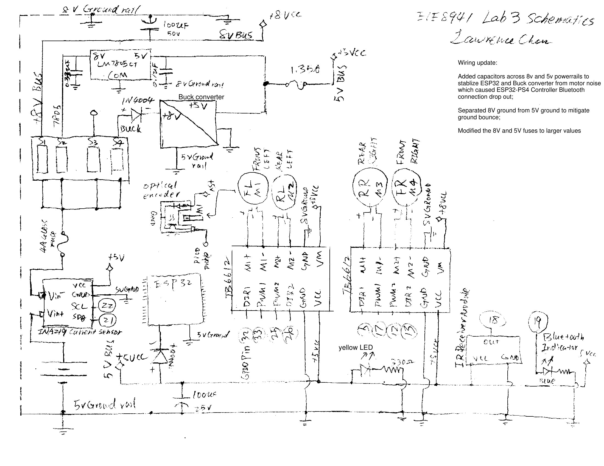

# ESP32-RC-Rover-with-POV-Cam
ESP32 robotic car with Bluetooth PS4 gamepad control, POV cam and multi-sensors for course project: ELE8941 Robotics and Controls, Semester 4, Electrical Engineering Technician Program, Algonquin College. 

Rover demo 1 full video: https://youtube.com/shorts/sIEPc9AW5L8?feature=share
POV demo 1 full video: https://youtu.be/2lEK4Y1qqqQ

Wiring schematics: 

