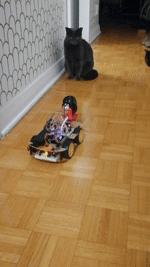
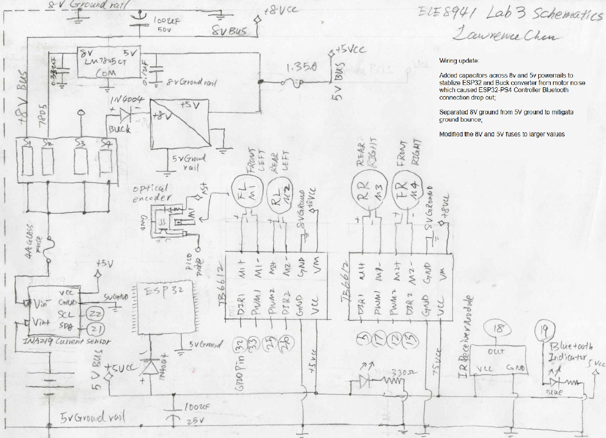
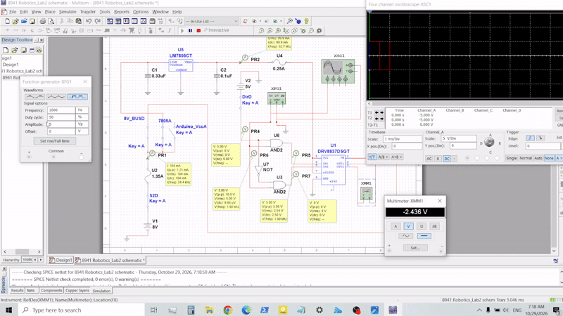

# ESP32-RC-Rover-with-POV-Cam
ESP32 robotic car with Bluetooth PS4 gamepad control, POV cam and multi-sensors for course project: ELE8941 Robotics and Controls, Semester 4, Electrical Engineering Technician Program, Algonquin College. 

Components: 
two 18650 rechargeable lithium Batteries, 8.2V at full capacity;

DC motor drivers: two TB6612 modules;

Stepper motor drivers: two LN2003 modules;

Current sensor: INA219;

VS1838B IR receiver module;

XL4016 buck converter;

Backup 7805 Voltage regulator circuit;

four TT DC Gearbox Motors; 

The POV cam is a budget wifi home camera with two 28BYJ-48 stepper motors, I re-routed the X and Y axis stepper motors to two LN2003 driver modules, and the camera feed is downloaded from the Tuya App.  

Rover demo 1 full video: https://youtube.com/shorts/sIEPc9AW5L8?feature=share

POV demo 1 full video: https://youtu.be/2lEK4Y1qqqQ

Wiring schematics: 

Multisim motor driver PWM simulation: 
This is a Multisim PWM motor driver simulation for 1 DC motor control.
I could not find the Multisim library for TB6612 Driver on Multisim 14.3, so I used the existing DRV8837 in the library to for demonstration purposes. Since for this driver chip IN1 and IN2 need to be swapped in order to reverse the direction, a AND-NOT gate combo was used to swap the input lines. the 5V source is used to simulate Arduino directional pins, and function. 
I'm running on college cloud VPN so the software does not run very smoothly, nevertheless, the simulation gets the point across, showing approximate DC voltages of about 2.5V on a 50% duty cycle from the function generator (simulating ESP32 PWM outputs)   
 
