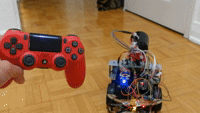
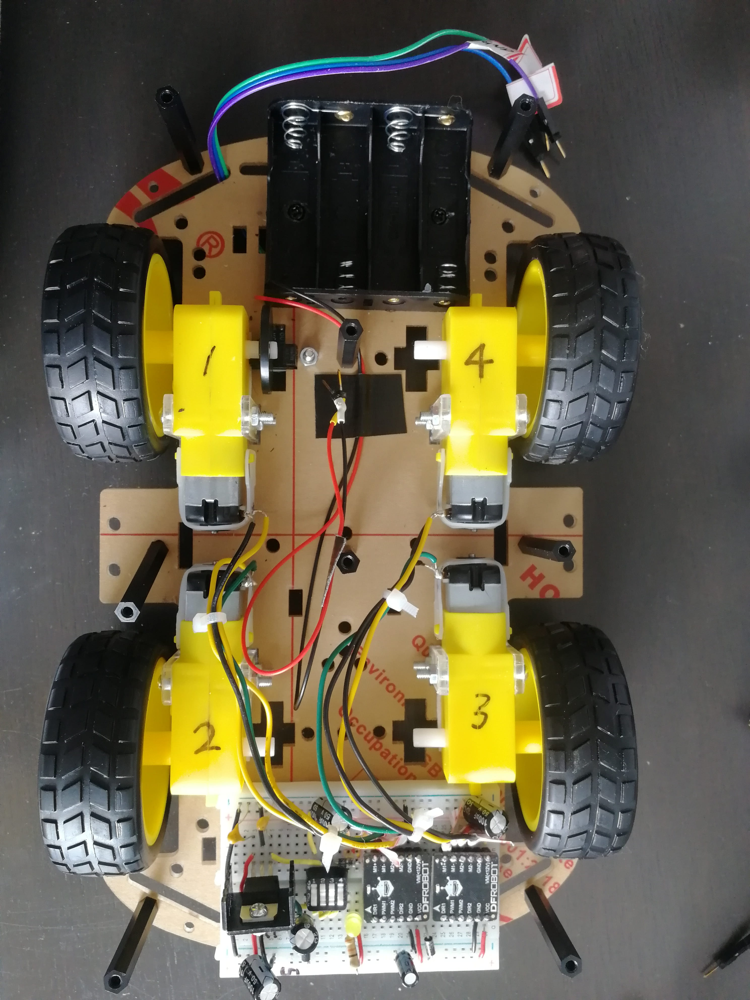
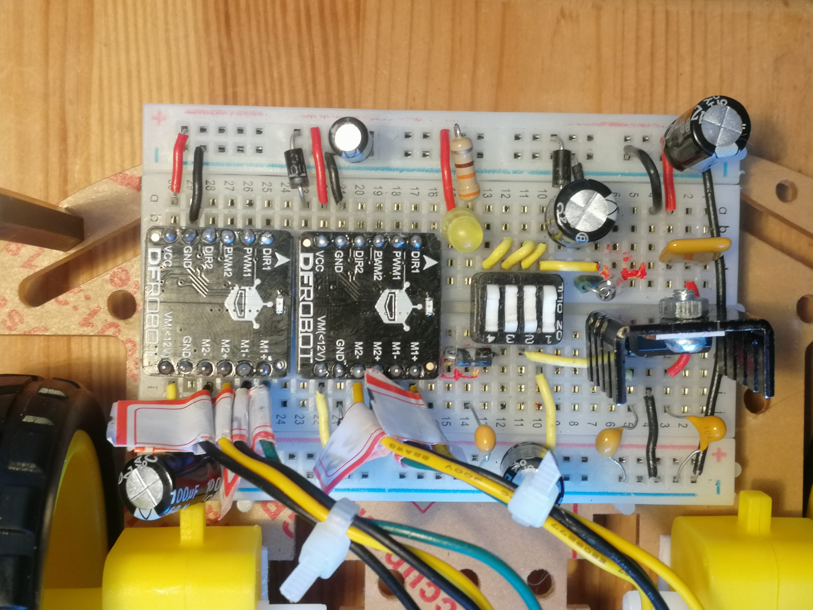
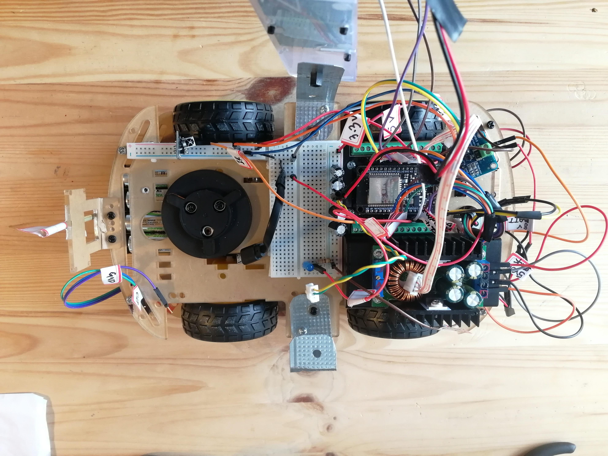
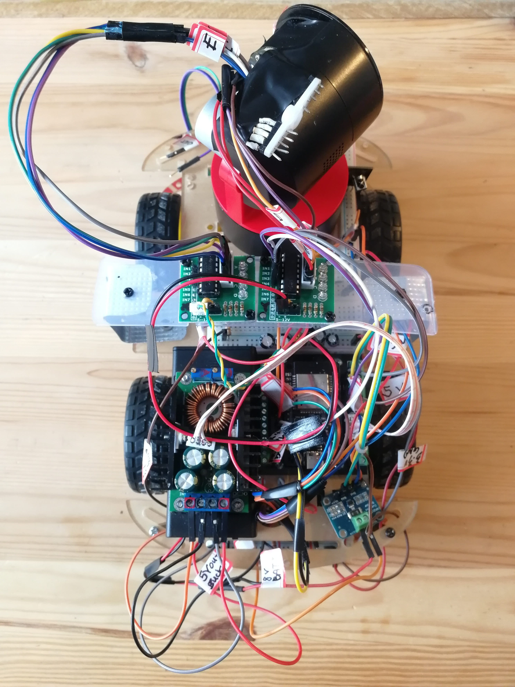
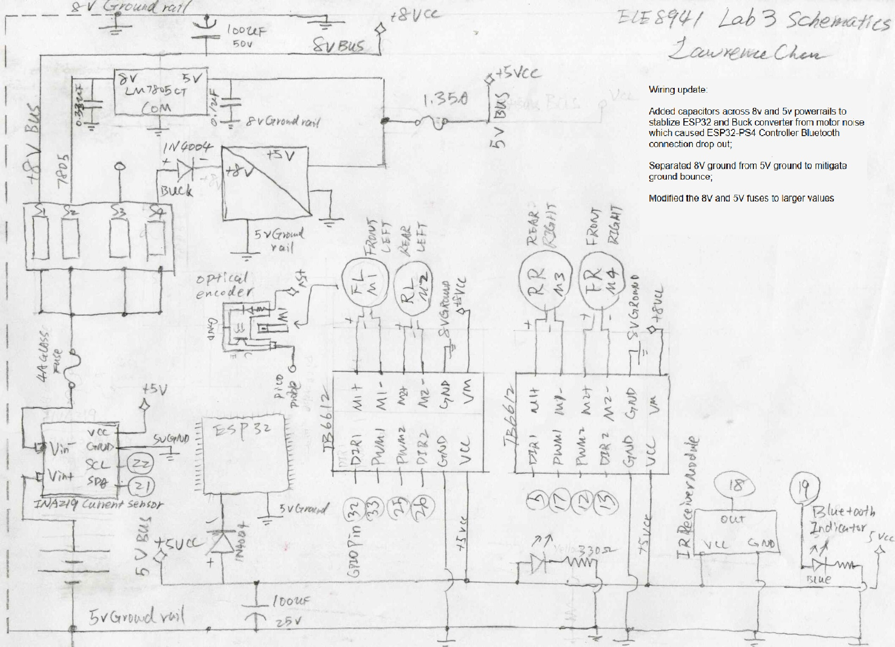
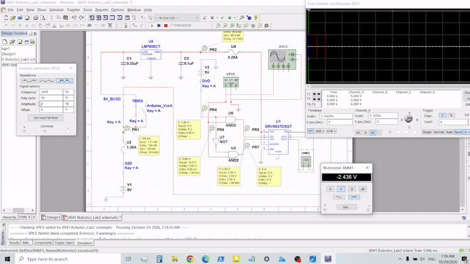

# Project Description
This robotic project is an ESP32 rover featuring Bluetooth PS4 gamepad control, and a 2-axis POV camera with stepper motors. Other key on-board modules and components include TB6612 DC motor drivers, ULN2003 Stepper motor drivers, INA219 current sensor, a VS1838B IR receiver module for testing operations, and voltage regulator circuit with LM7805, and an optional XL4016 buck converter.

With core feature of Bluetooth motor controls, my rover is an extension from a course project: ELE8941 Robotics and Controls, Semester 4, Electrical Engineering Technician Program, Algonquin College. 

This project proved to be an invaluable learning experience introducing me to advanced topics in embedded firmware and power electronics. Join me along this journey, as I highlight and document key progressions such as improving code architecture for motor controls, troubleshooting Bluetooth connection issues, wiring for galvanic isolation, and battery power management. 

**Components:** 

Power source: Two ICR18650, 3.7V rechargeable lithium Batteries with 2600mAh. 8.2V at full capacity in series. 

Car movement: Four TT DC Gearbox Motors controlled by two TB6612  DC motor driver modules;

POV Camera movement: Two 28BYJ-48 stepper motors with two LN2003 driver modules;

Sensors and Low-power modules: INA219 Current sensor; VS1838B IR receiver module;

Voltage regulator: LM7805 circuit; (Optional: XL4016 buck converter;)

The POV cam is a budget wifi home camera with two 28BYJ-48 stepper motors for the the X and Y axis movement; I rewired the motors onto two LN2003 driver modules. For the camera video, the camera itself connects to Wifi, and the video feed can be streamed and downloaded from the Tuya App on mobile devices. 

Rover demo 1 full video: https://youtube.com/shorts/sIEPc9AW5L8?feature=share

POV demo 1 full video: https://youtu.be/2lEK4Y1qqqQ

**Robot Assembly:**

Lower plate assembly:

Power circuit:

Upper plate assembly: 

Complete assembly: 

**Wiring and Schematics:**

DC wheel motors: 

Stepper Motors: 

Power, wiring and grounding: 

**PWM Simulation**
Multisim motor driver PWM simulation: 
This is a Multisim PWM motor driver simulation for 1 DC motor control.
I could not find the Multisim library for TB6612 Driver on Multisim 14.3, so I used the existing DRV8837 in the library to for demonstration purposes. Since for this driver chip IN1 and IN2 need to be swapped in order to reverse the direction, a AND-NOT gate combo was used to swap the input lines. the 5V source is used to simulate Arduino directional pins, and function. 
I'm running on college cloud VPN so the software does not run very smoothly, nevertheless, the simulation gets the point across, showing approximate DC voltages of about 2.5V on a 50% duty cycle from the function generator (simulating ESP32 PWM outputs), 
and about 3.5V on 70% duty cycle. 

 

**Code Structures:**

**Motor Control structure:**
Global variables for motor control: 

https://github.com/Lorentz-DC/ESP32-RC-Rover-with-POV-Cam/blob/c702659eab681ca937facb6cbbe97cdf01d75455/Robot_Car_Nov8_New_motor_control.ino#L59-L67

Write motor block: 
Modular individual motor control function with parameters;
MOSFET Shoot-through protection during direction changes; 

https://github.com/Lorentz-DC/ESP32-RC-Rover-with-POV-Cam/blob/c702659eab681ca937facb6cbbe97cdf01d75455/Robot_Car_Nov8_New_motor_control.ino#L203-L263

motor stop block: 
with the parameterized write_Motor logic in place, the motor_stop function can be easily written: 

https://github.com/Lorentz-DC/ESP32-RC-Rover-with-POV-Cam/blob/c702659eab681ca937facb6cbbe97cdf01d75455/Robot_Car_Nov8_New_motor_control.ino#L265-L273

motor control block: 

https://github.com/Lorentz-DC/ESP32-RC-Rover-with-POV-Cam/blob/c702659eab681ca937facb6cbbe97cdf01d75455/Robot_Car_Nov8_New_motor_control.ino#L276-L366

Non-blocking code with millis();

Gate-latching DC motor controls on ESP32;

AnalogWrite() and ledcWrite() on ESP32 vs Arduino MCU;

**execution layers and main loop:**
Bluepad32 for joystick controls, IR receiver for testing;
motor control logic is nested in if(dataUpdated) condition so that it activates when PS4 controller is Bluetooth connected;

https://github.com/Lorentz-DC/ESP32-RC-Rover-with-POV-Cam/blob/1c9eb0c3103c0ccc38013dc3d27ea864f9c161dd/Robot_Car_Nov8_New_motor_control.ino#L695-L740

**Troubleshooting:** 
Bluetooth dropout: ground bounce and voltage sagging;
Bluetooth drop-out problem: register thrashing and dual-core bus contention;

