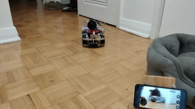
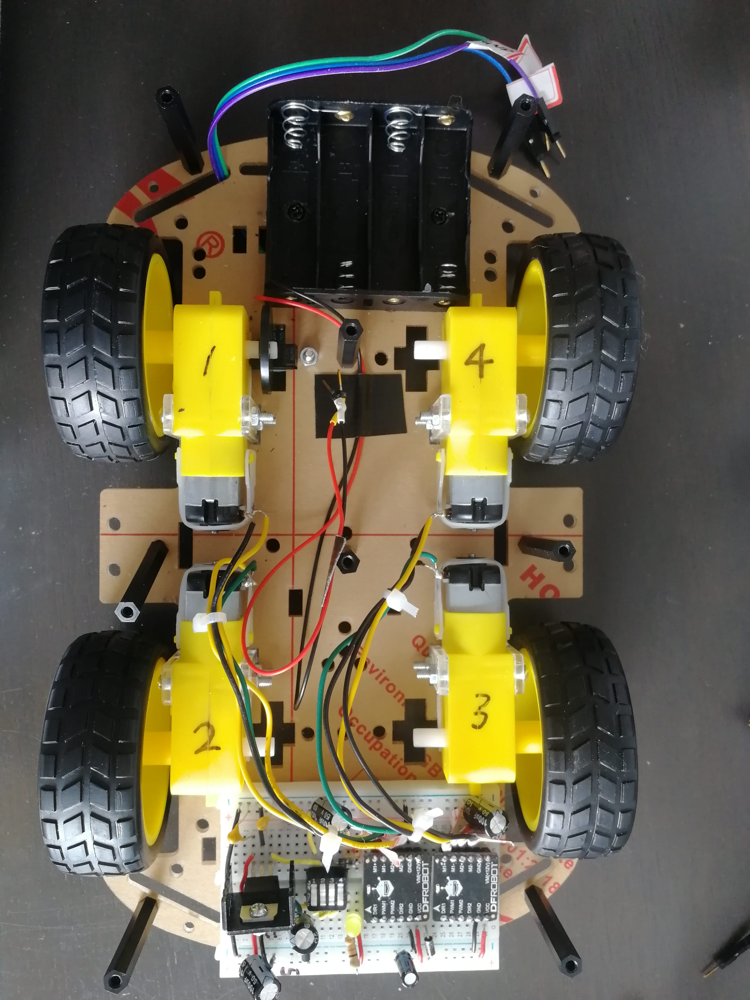
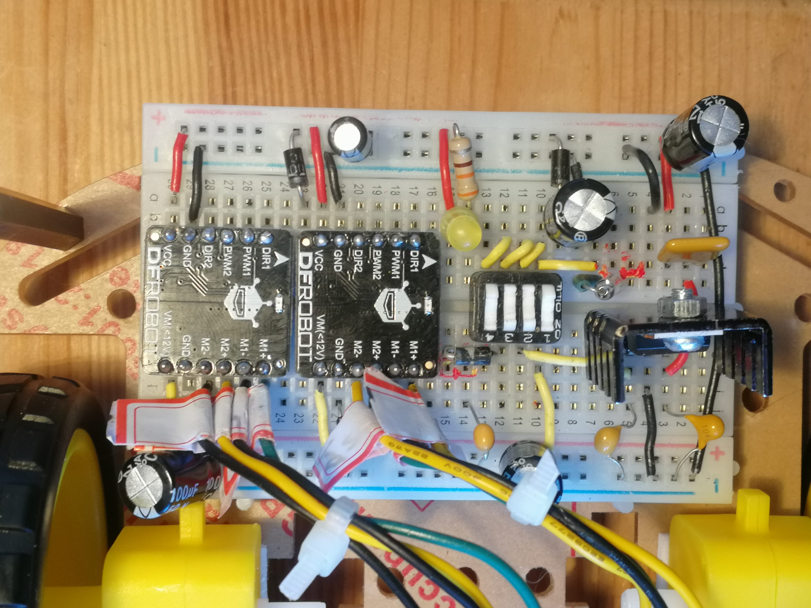
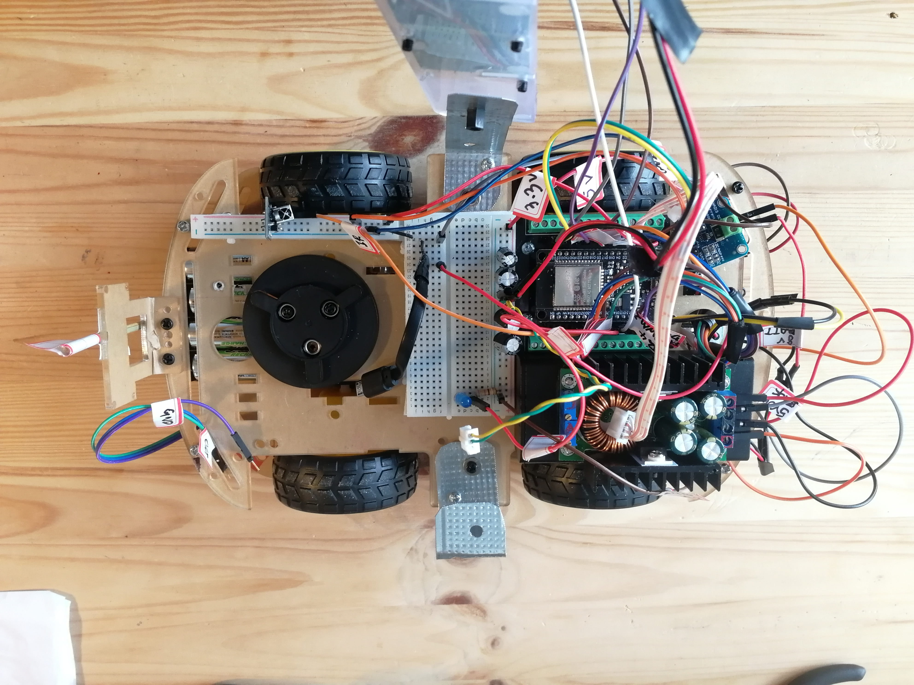
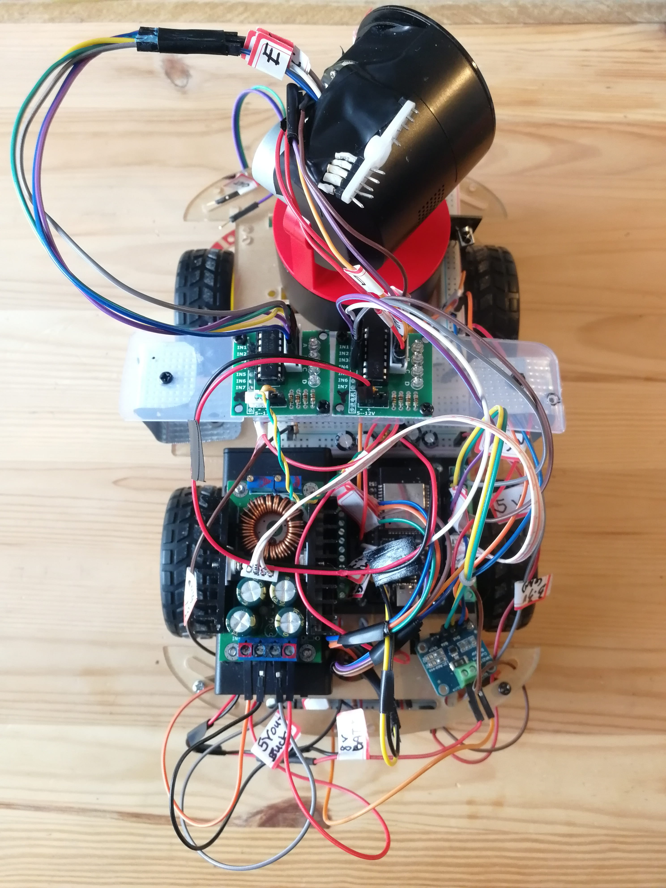
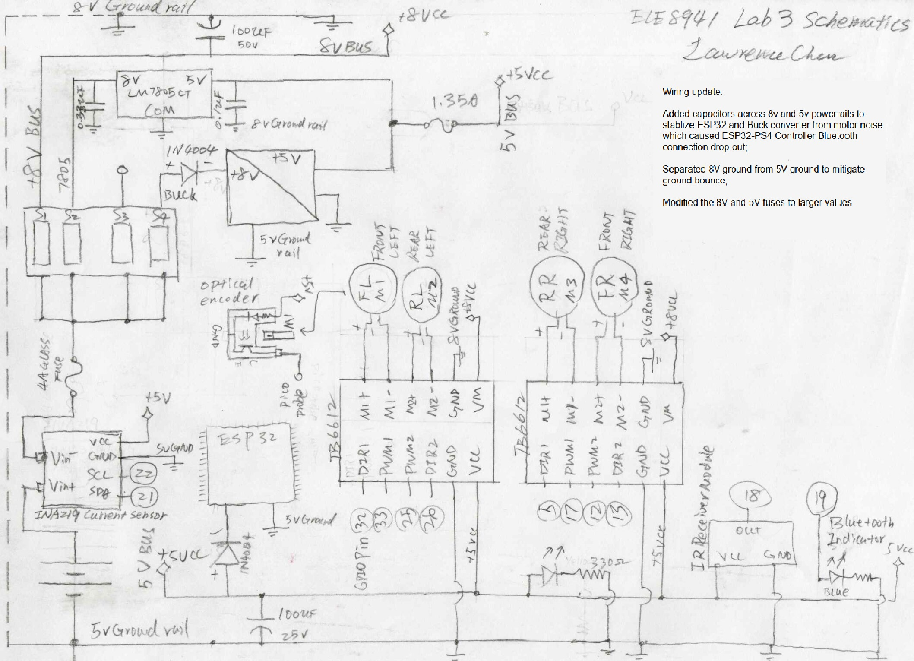
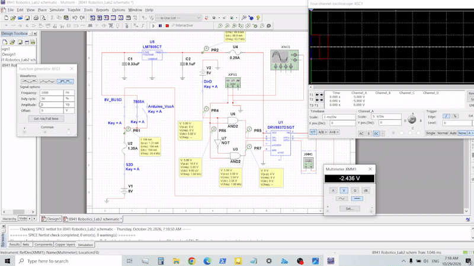
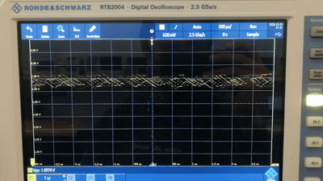
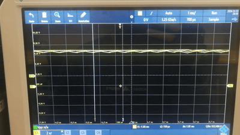
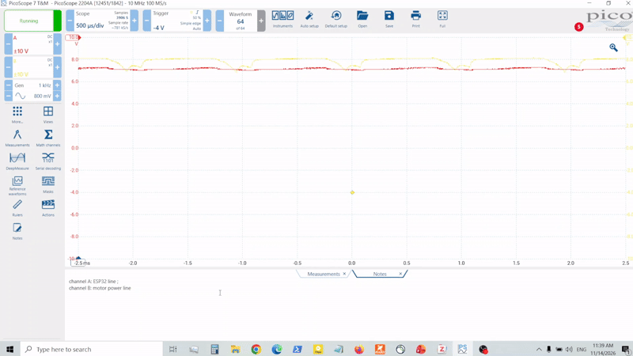

# Project Description
This robotic project is an ESP32 rover featuring Bluetooth PS4 gamepad control, and a 2-axis POV camera with stepper motors. Other key on-board modules and components include TB6612 DC motor drivers, ULN2003 Stepper motor drivers, INA219 current sensor, a VS1838B IR receiver module for testing operations, and voltage regulator circuit with LM7805, and an optional XL4016 buck converter.

With core feature of Bluetooth motor controls, my rover is an extension from a course project: ELE8941 Robotics and Controls, Semester 4, Electrical Engineering Technician Program, Algonquin College. 

This project proved to be an invaluable learning experience introducing me to advanced topics in embedded firmware and power electronics. Join me along this journey, as I highlight and document key progressions such as improving code architecture for motor controls, troubleshooting Bluetooth connection issues, wiring for galvanic isolation, and battery power management. 

**Components:** 

Power source: Two ICR18650, 3.7V rechargeable lithium Batteries with 2600mAh. 8.2V at full capacity in series. 

Car movement: Four TT DC Gearbox Motors controlled by two TB6612  DC motor driver modules;

POV Camera movement: Two 28BYJ-48 stepper motors with two LN2003 driver modules;

Sensors and Low-power modules: INA219 Current sensor; VS1838B IR receiver module;

Voltage regulator: LM7805 circuit; (Optional: XL4016 buck converter;)

The POV cam is a budget wifi home camera with two 28BYJ-48 stepper motors for the the X and Y axis movement; I rewired the motors onto two LN2003 driver modules. For the camera video, the camera itself connects to Wifi, and the video feed can be streamed and downloaded from the Tuya App on mobile devices. 

Rover demo 1 full video: https://youtube.com/shorts/sIEPc9AW5L8?feature=share

POV demo 1 full video: https://youtu.be/2lEK4Y1qqqQ

**Robot Assembly:**

Lower plate assembly:

Power circuit:

Upper plate assembly: 

Complete assembly: 

**Wiring and Schematics:**

Update: Due to voltage brown-out issues on the ESP32 supply line discussed in the sections below, I've removed the buck converter and put the ESP32 on a separate 8V line, and later put decoupling filter circuit to clean up the supply. 

DC wheel motors: 

Stepper Motors: 

Power, wiring and grounding: 

**PWM Simulation**
Multisim motor driver PWM simulation: 
This is a Multisim PWM motor driver simulation for 1 DC motor control.
I could not find the Multisim library for TB6612 Driver on Multisim 14.3, so I used the existing DRV8837 in the library to for demonstration purposes. Since for this driver chip IN1 and IN2 need to be swapped in order to reverse the direction, a AND-NOT gate combo was used to swap the input lines. the 5V source is used to simulate Arduino directional pins, and function. 
I'm running on college cloud VPN so the software does not run very smoothly, nevertheless, the simulation gets the point across, showing approximate DC voltages of about 2.5V on a 50% duty cycle from the function generator (simulating ESP32 PWM outputs), 
and about 3.5V on 70% duty cycle. 

 

**Code Structures:**

**Motor Control structure:**

Global variables for motor control: Modularized and parameterized write_Motor() function;
the array values are to store the last PWM speed and direction of each motor;

https://github.com/Lorentz-DC/ESP32-RC-Rover-with-POV-Cam/blob/c702659eab681ca937facb6cbbe97cdf01d75455/Robot_Car_Nov8_New_motor_control.ino#L59-L67

write_Motor function: 

Modular individual motor control function with parameters;
MOSFET Shoot-through protection during direction changes; 

https://github.com/Lorentz-DC/ESP32-RC-Rover-with-POV-Cam/blob/c702659eab681ca937facb6cbbe97cdf01d75455/Robot_Car_Nov8_New_motor_control.ino#L203-L263

This function uses a parameterized method that writes to each of the four motors specifying direction and PWM speed, using two global array values of PWM speed and direction of each motor, it compares the last stored value with the new write PWM or directional values, i.e, "edge triggers";
If the values are not changed, the function exits, if either of the values is different, write to that specific value with analogwriting PWM speed or digital writing direction pin. By specifying motor_num 0-3 in the function parameter, the funcion uses switch case method to write to each motor the specified values. 
When there is sudden directional change, the function features a brief pause of movement and then writes the reverse direction, protecting H-bridge MOSFET from shorts. 

This modularized function not only makes it very easy and efficient to write motion control logic ( forward/reverse, piviots, veer. )later on, The biggest benifit of this function is for continous bluetooth joystick motion control. If only the non-gated analogWrite and digitalWrite lines are used for each type of movement (forward, veer, etc) in the movement control logic, the function will run at loop speed and continously write to registers even if no new inputs from the joysticks are made.
This continous writing on the register will cause CPU overhead and glitches in robot movement, especially since analogWrite() is an older version of command rather than the ledcWrite on ESP32.
To make up for this problem, millis() and vtaskDelay methods has to be used in the mainloop() to prevent register flooding. 
In contrast, the gated method writes to individual motor registers the new values only once, and only if value differences are detected, it is more effieicnt to run on the ESP32 CPU and prevents register problems, and no millis() gating or vtaskDelay is necessary, only optional.  

motor stop block: 
with the parameterized write_Motor logic in place, the motor_stop function can be easily written: 

https://github.com/Lorentz-DC/ESP32-RC-Rover-with-POV-Cam/blob/c702659eab681ca937facb6cbbe97cdf01d75455/Robot_Car_Nov8_New_motor_control.ino#L265-L273

motor control block: 
note: in the veer functions of left or right, the veer values are added as a parameter, adding into the PWM values of the the left side of motors to veer right, or vice versa.
//note that reverse_veer_right or _left basically returns the car to its original position, while the veering curve stays the same. perhaps we should call it veer starboard or portside instead. 

https://github.com/Lorentz-DC/ESP32-RC-Rover-with-POV-Cam/blob/c702659eab681ca937facb6cbbe97cdf01d75455/Robot_Car_Nov8_New_motor_control.ino#L276-L366

**execution layers and main loop:**

Bluepad32 for joystick controls, IR receiver for testing;
motor control logic is nested in if(dataUpdated) condition so that it activates when PS4 controller is Bluetooth connected;

https://github.com/Lorentz-DC/ESP32-RC-Rover-with-POV-Cam/blob/1c9eb0c3103c0ccc38013dc3d27ea864f9c161dd/Robot_Car_Nov8_New_motor_control.ino#L695-L740

**Power and signal integrity** 

A persistent issue I have encountered has been Bluetooth dropping-out when the car is running on all 4 DC motors and 2 stepper motors, which causes ESP32 to disconnect from the PS4 controller, freezing the car. After troubleshooting and eliminating hypotheses on software and wiring issues, I've identified the cause to be sudden voltage drops due to either DC motor interference, or battery capacity issues. I cleaned up the ESP32 supply line with decoupling circuit, which improved noise, but momentary voltage drop still persists, pointing to battery capacity issues. Below are the oscilloscope measurement demonstrations highlighting the troubleshooting process. 

For this measurement on the unfiltered 8V power rail for the ESP32 line, oscilloscope time scale set to 500 microseconds; resting battery voltage is around 7.6-7.8V, which is about 6-70% capacity; The PS4 controller is revving all 4 motors on the bench.
as we can see there is substantial noise and voltage fluctuations, with period of each fluctuating wave roughly equal to 400-500 microseconds, this is roughly on the same scale with the running DC motor frequency of 8K RPM. 

Adding the decoupling filter: 

1N4004 diode + 330uF electrolytic capacitor "hold-up tank" circuit on the ESP32 8V supply line. note that the 1N4004 will tax a 0.2V to 0.7V drop across the junction, but it still leaves more than enough head room for the ESP32.  if we set the timer period we want the capacitor to cover to be the observed motor noise period of 500us, and assume peak current demand of ESP32 running at full load to be 500mA, given the capacitance 330uF, the calculated voltage drop mitigated by the capacitor should be delta_V = I*delta_t/C = 0.76V, which makes Vrest - Vmin = 0.76V. Given a resting voltage on the ESP32 line of 7.5V fully charged, the decoupled MCU supply voltage should sit comfortably above 6V, buffered by the capacitor. This value is consistent with the observed result on the oscilloscope. However, as we can also see on the oscilloscope, this kind of decoupling method cannot supply the sudden voltage plummets caused by weak battery capacity. 

In this measurement on the filtered 8V power rail for the ESP32 line, oscilloscope time scale was set to 250 microsecond, and then 500us, then 1 ms in this gif clip, we can see the motor noise has been substantially cleaned; However, the real root cause of our Bluetooth problem has been exposed, since this time resting battery voltage is only about 7V, the battery is practically empty. When all 4 motors are revving via the controller, we can see massive momentary voltage drops due to weak battery capacity, and at the moment right when voltage plummeted to around 2.5V across the screen, the Bluetooth dropped out again. 

Side by side comparison on PC picoscope:

here channel A in the red is measuring ESP32 8V supply line, and channel B in yellow is measuring DC motor 8V supply line. When the battery is about fully charged, we can see that the unfiltered motor rail fluctuating from 8V to 6V when revving on the bench, and the ESP32 line shows significantly stabilized voltage range of about 7.3V to 6.8V. However, soon afterwards, we can see that voltage on both motor and MCU lines suddenly plummeted down to 2V, cutting ESP32's Bluetooth out, indicating battery capacity issues. 

**Battery power management** 

